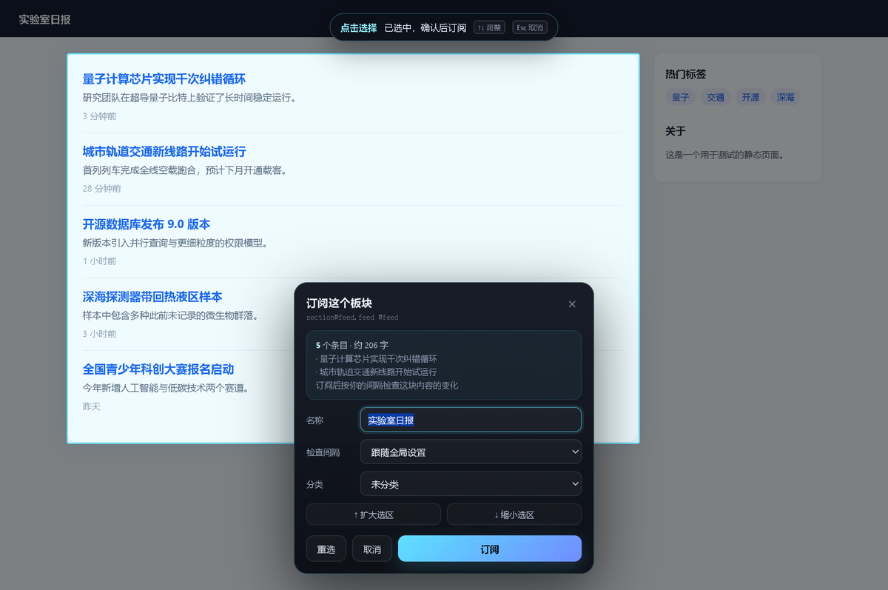
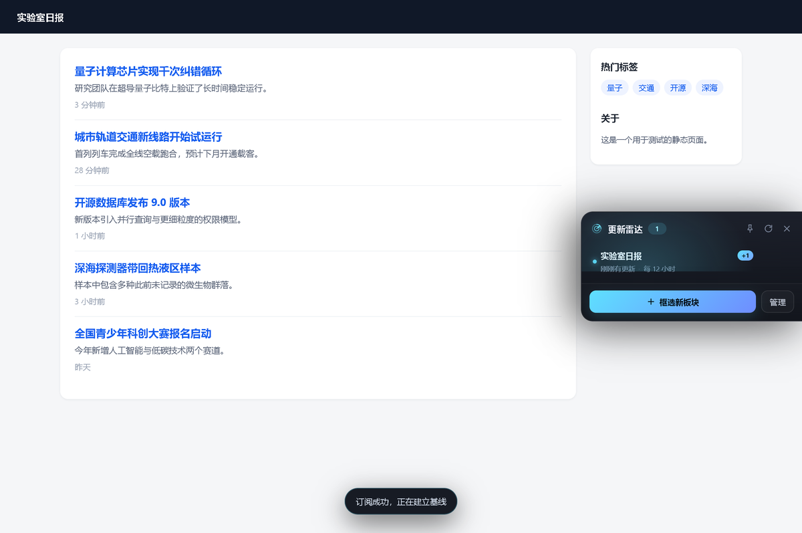
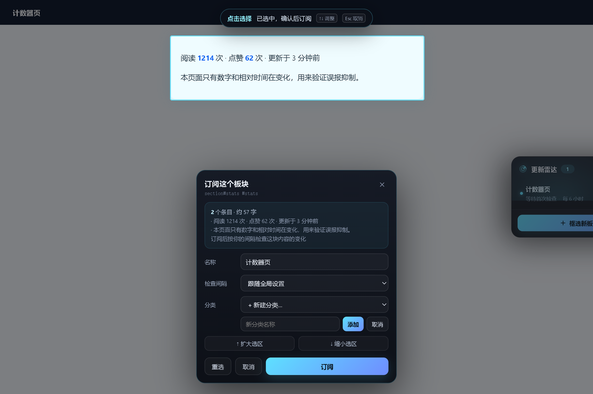
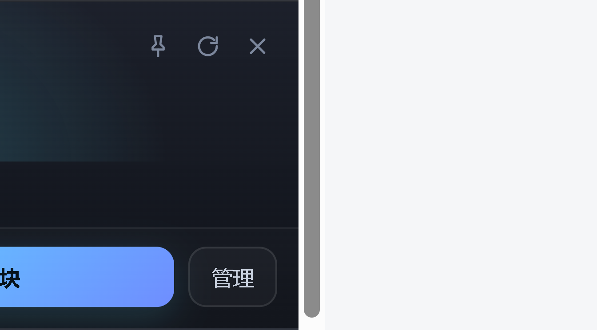
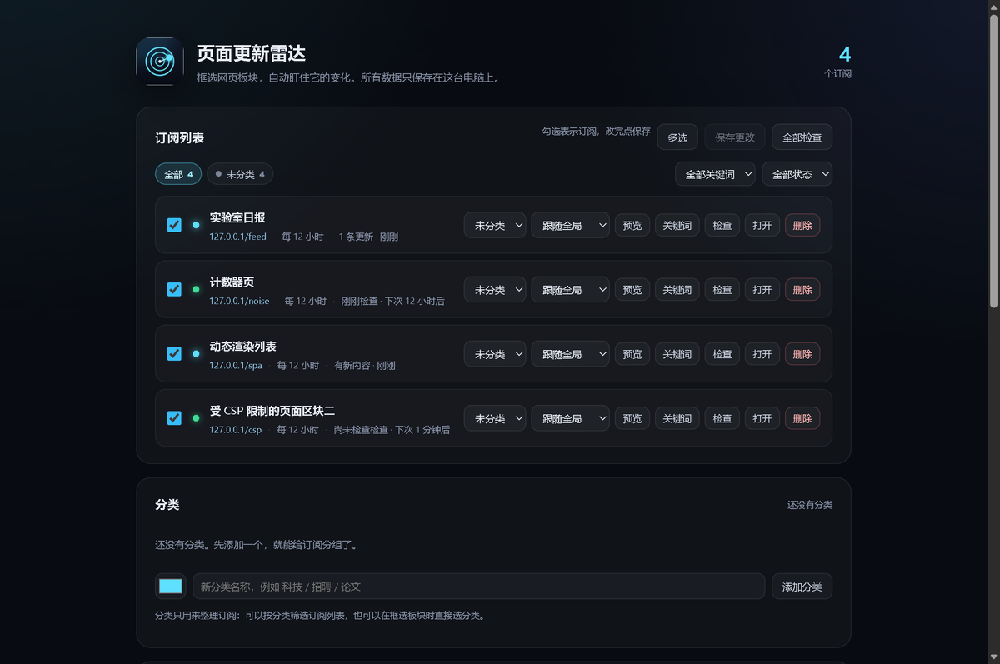
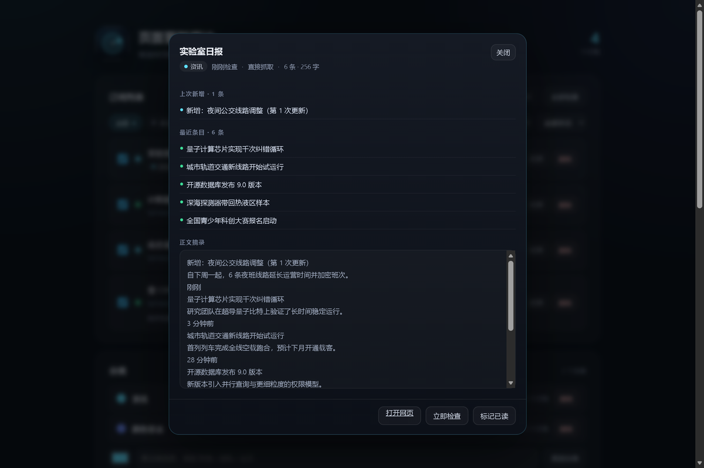
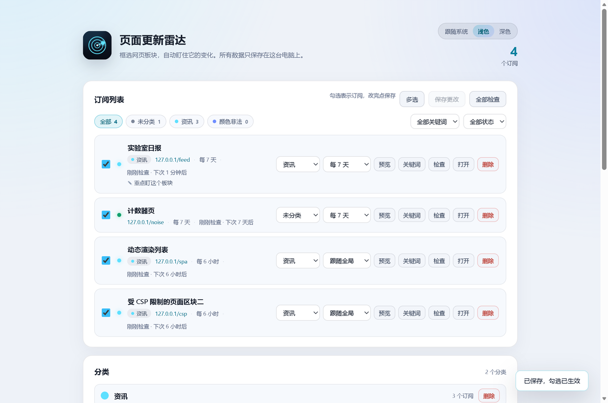
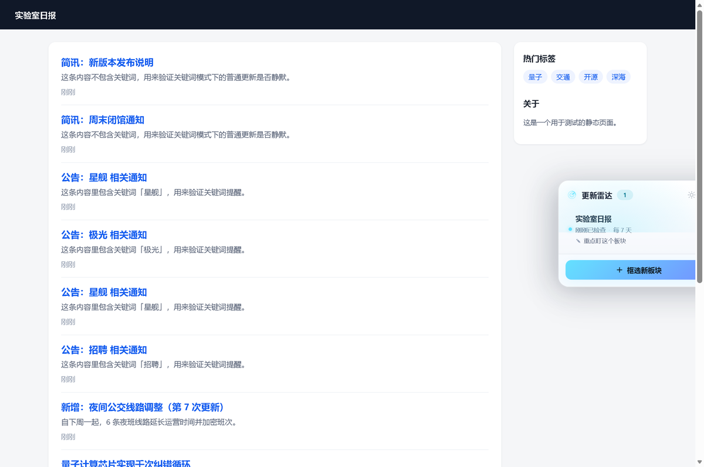

# 页面更新雷达 · PageRadar

一个 Chrome / Edge 扩展（Manifest V3）：在任意网页上**框选一个板块**，它就会按你设定的节奏盯着那块内容，有变化时用系统通知和页面角落的悬浮窗提醒你。

不用注册、不用账号、不上传任何数据——订阅和快照都只存在本机 `chrome.storage.local` 里。

**直接下载** → [最新版本 Release](https://github.com/yuxigongzi/page-radar/releases/latest)：在页面底部的 **Assets** 里点 `page-radar-x.y.z.zip`，解压后按下方「安装 · 方式一」加载即可。

> 想自己改代码、跑测试、重新打包？看 [DEVELOPER.md](DEVELOPER.md)。

---

## 能做什么

- **像 F12 点选一样框选**：点工具栏图标 →「框选本页板块」，鼠标移到哪里就高亮哪里，点一下即选中。`↑` 选父级、`↓` 选子级、`Enter` 确认、`Esc` 取消，也可以用卡片上的「扩大选区 / 缩小选区」。
- **自动识别列表**：选中的区域如果是列表，会按条目（标题或链接）比对，新增一条就是一条更新，而不是整段文字变了；同时保留整段文本哈希，文案被改写也能发现。
- **随时预览**：悬浮窗里每条订阅右侧有眼睛按钮，设置页每行有「预览」按钮，点开就能看到最近一次检查抓到的条目、上次新增了什么、以及正文摘录。
- **按分类整理**：新建分类（8 种配色，可改名、可删），框选时直接选分类——分类下拉的最后一项就是「+ 新建分类…」，不用切到设置页；之后按分类筛选，弹窗和悬浮窗里也会显示彩色标签。
- **给每个订阅写备注**：悬浮窗里每条订阅右侧有铅笔按钮，点一下就能写一句备注（比如「等面试通知」「盯价格」），回车保存；设置页和弹窗里会一起显示。
- **勾选是否订阅（保存后生效）**：设置页每行最左边是勾选框，取消勾选并点「保存更改」后订阅暂停——不参与定时检查、不发通知、不占角标，但快照和预览仍然留着；重新勾选保存后 30 秒内恢复检查。
- **关键词提醒**：给订阅设一组关键词后，这个板块**只在关键词新出现时**提醒；普通更新不再发通知。关键词不区分大小写，最多 12 个，可匹配整段板块文本和条目标题，匹配方式可选「包含任意一个」或「全部同时出现」。
- **筛选、多选、批量操作**：按分类 / 关键词 / 状态筛选；「多选」后勾选或「全选筛选结果」，批量设关键词、批量改分类。
- **按筛选 / 按选中导出**：只带走某个分类的规则，方便换机器。
- **减少误报**：默认忽略「3 分钟前」「1,234」这类纯相对时间和数字的变化（可在设置里关掉）。
- **每天首次 + 固定间隔**：浏览器当天第一次启动时检查一遍全部订阅，之后每隔 N 小时（默认 12 小时，可选 1/3/6/12/24/48 小时或每周，也可给单个订阅单独设置）再检查。
- **自动隐藏的悬浮窗**：贴在页面边缘，收起时只露出一半；鼠标移上去展开，可固定、可调透明度（默认 92%）、可整站关闭（在弹窗里重新打开）。
- **点通知回到现场**：点系统通知会切到对应标签页、滚动到那个板块并高亮 2 秒。
- **备份与恢复**：导出全部 / 仅设置 / 筛选结果 / 所选；导入前先看摘要，再选合并或覆盖，可选是否恢复设置。
- **浅色 / 深色 / 跟随系统**：设置页右上角切换，弹窗和悬浮窗（悬浮窗头部的小图标按钮）一起跟着变；选「跟随系统」时随操作系统外观自动切换。

---

## 界面

| 框选板块 | 悬浮窗（收起时只露一半） |
| --- | --- |
|  |  |

| 框选时直接新建分类 | 给订阅加备注 |
| --- | --- |
|  |  |

| 设置与订阅管理 | 预览最近一次快照 |
| --- | --- |
|  |  |

| 浅色主题的设置页 | 浅色主题的悬浮窗 |
| --- | --- |
|  |  |

---

## 安装

### 方式一：加载已解压目录（最稳妥）

1. 下载或克隆本目录（`page-radar/`）。
2. 打开 `chrome://extensions`（Edge 是 `edge://extensions`），右上角开启「开发者模式」。
3. 点「加载已解压的扩展程序」，选择 `page-radar` 目录。
4. 建议把图标固定到工具栏。

### 方式二：安装打包好的 `.crx`

1. 打开 `chrome://extensions`，开启「开发者模式」。
2. 把 `dist/page-radar-1.7.0.crx` 拖进这个页面，弹窗里点「添加扩展程序」。
3. 如果浏览器拒绝安装非商店来源的 CRX，改用方式一，功能完全一致。

`.crx` 用 `dist/page-radar-key.pem` 签名，所以同一把钥匙打出来的包扩展 ID 恒定（当前为 `dpoeapfhmckplfackhnbohmelanlofba`），后续版本覆盖安装会被认作同一个扩展、订阅数据不会丢。**这个 pem 文件请自己留着**：换机器后没有它就无法产出同 ID 的 CRX，只能重新安装并重新订阅。

> Chromium 137 之后的**正式版 Chrome** 不再接受命令行 `--load-extension`，但手动「加载已解压的扩展程序」仍然可用；本扩展的所有功能都不依赖命令行开关。

---

## 使用说明

### 1. 订阅第一个板块

1. 打开想盯着的页面，点工具栏图标 →「框选本页板块」。
2. 移动鼠标选中板块（比如一个新闻列表、一个公告栏），左上角会显示选择器、右侧卡片显示预览条目数。
3. 需要的话改个名字、选个分类、单独设置检查间隔，点「订阅」。

订阅后后台会立刻存一份基线快照；之后的变化都跟这份基线比。

### 2. 悬浮窗：收起时只露一半

- 订阅成功后，页面右侧（可在设置里改成左侧）出现悬浮窗，收起状态只露出宽度的一半。
- 鼠标移上去自动展开；点图钉固定展开；点 × 关闭只对当前网站生效，可在弹窗里重新打开。
- 面板里列出本页订阅、未读条数、上次检查时间；点某一条会滚动并高亮到对应板块。
- 面板右上角的小圆图标（◐ / ☀ / ☾）用来切换主题：跟随系统 → 浅色 → 深色，改完立刻保存，所有页面的悬浮窗一起变。

### 3. 预览：到底变了什么

三个入口，内容一样：

- 悬浮窗里订阅右侧的**眼睛**按钮 → 面板里展开抽屉；
- 设置页每行「预览」→ 弹出窗口；
- 弹窗里点某条订阅 → 切换成预览视图。

预览里有：分类标签、上次检查时间、抓取方式（直接抓取 / 后台渲染）、条目数与字数、上次新增了什么、最近条目列表、正文摘录。底部可以「打开网页」「立即检查」「标记已读」。

### 4. 分类

- 设置页「分类」卡片里新建（自动分配配色），点色块改颜色，点名字改名，右侧可删除（删除后相关订阅自动变成「未分类」）。
- 框选时卡片上直接选分类；下拉最后一项是「+ 新建分类…」，选中后在卡片里输入名字，回车或点「添加」即可，新分类会立刻建好并自动选中，不用先去设置页。
- 设置页每行也能改分类。
- 列表上方的分类标签可以筛选，标签上带该分类的订阅数量。

### 5. 备注

- 悬浮窗里每条订阅右侧有铅笔按钮，点开是一个小输入框，写完按回车或点「保存」。
- 备注会跟着订阅走：设置页每行、浏览器弹窗里都会显示在名称下面；清空备注就再点一次铅笔、删掉文字保存。
- 备注只给你自己看，不参与检查，也不影响通知。

### 6. 暂停某个订阅（保存后生效）

设置页每行最左边是勾选框。取消勾选后点顶部的「保存更改 (N)」才真正生效：

- 暂停的订阅不参与定时检查、不发通知、不占角标；
- 快照、预览、分类、关键词都保留；
- 手动「立即检查」会被拒绝，并提示先勾选启用；
- 重新勾选并保存后，30 秒内安排一次检查。

### 7. 关键词提醒

**单个订阅**：设置页那一行点「关键词」→ 输入词 → 回车或「添加」变成气泡 → 选匹配方式 → 保存。

**批量设置**：点「多选」→ 勾选或「全选筛选结果」→ 点「批量关键词」→ 输入词 → 保存。

- 关键词不区分大小写，最多 12 个，会匹配整段板块文本和条目标题；
- 「包含任意一个」：任一关键词出现即提醒；「全部同时出现」：要求的词全部出现才提醒；
- 关键词模式的订阅，**普通内容更新不再发通知**，只有新命中才提醒；
- 同一个命中不会反复提醒，直到这个板块里该词消失后再次出现；
- 清空关键词即恢复普通更新提醒；
- 输入框里打完字直接点「保存」也会自动收进去，不必先点「添加」；批量保存时如果词列表是空的，会先弹确认，避免误清空一整批订阅。

### 8. 筛选、多选与批量操作

- 筛选：分类标签 + 关键词下拉（全部关键词 / 有关键词 / 无关键词 / 某个具体词）+ 状态下拉（全部 / 启用中 / 已暂停 / 有新内容 / 检查失败）。
- 多选：点「多选」进入选择模式，点行即勾选；「全选筛选结果」只选当前筛选出来的那些。
- 底部批量条：批量关键词、批量分类、导出所选。
- 批量关键词/分类都是**覆盖**写入，不是追加。

### 9. 备份与换机

设置页底部「备份与恢复」：

- 「导出全部备份」：设置 + 分类 + 全部订阅；
- 「仅导出设置」：只带偏好；
- 「导出筛选结果」/「导出所选」：只带当前筛选或勾选的那几条；
- 「导入备份…」：选 JSON → 看到摘要（新增几个、重合几个、几个分类）→ 选「合并导入」或「覆盖导入」，还能勾选是否一起恢复设置。

备份不含抓取到的快照，导入后会重新建立基线，不会因为导入就误报一堆更新。

### 10. 设置项一览

| 设置 | 默认 | 说明 |
| --- | --- | --- |
| 检查间隔 | 12 小时 | 1/3/6/12/24/48 小时或每 7 天；单个订阅可覆盖 |
| 每天首次启动时检查 | 开 | 浏览器当天第一次启动跑一遍全部订阅 |
| 有更新时发系统通知 | 开 | 关闭后只在弹窗/悬浮窗里显示未读 |
| 忽略纯时间/数字变化 | 开 | 抑制「3 分钟前」「1,234」这类噪声 |
| 显示悬浮窗 | 开 | 关闭后所有页面都不显示 |
| 悬浮窗位置 | 右侧 | 左 / 右 |
| 悬浮窗透明度 | 92% | 30%–100% |
| 新订阅沿用上一个订阅的分类 | 关 | 打开后框选时默认选中上次用的分类 |
| 主题 | 跟随系统 | 跟随系统 / 浅色 / 深色，设置页右上角切换；弹窗与悬浮窗同步 |

---

## 常见问题

**chrome://extensions 里出现 CSP 相关的错误记录？**
1.5.1 之前，离屏解析时页面 HTML 里的 `on*` 内联事件属性会被 `DOMParser` 编译，触发扩展 CSP 并留下一条违例记录（处理器并未执行，只是记录）。现在解析前会先剥掉这些属性。更新到最新版后点一下「清除全部」即可。

**拖入 .crx 时提示「该扩展程序未列在 Chrome 应用商店中」？**
较新的 Chrome 正式版硬性拦截非商店来源的 CRX，没有「继续安装」。改用「加载已解压的扩展程序」即可，功能完全一样。

**悬浮窗不出现？**
- 设置里「显示悬浮窗」是否关闭；
- 这个网站是否被单独关过（弹窗 →「在本站显示悬浮窗」）；
- 当前页面是否有本页订阅（没有订阅时不显示）。

**页面明明变了，却没收到通知？**
- 订阅处于暂停状态（行内显示「已暂停」）；
- 变化只是相对时间或数字，被「忽略纯时间/数字变化」过滤了；
- 这个订阅设了关键词，而这次变化没有命中关键词；
- 这条变化之前已经提醒过（同一个命中不会重复提醒，标为已读后也不重复）。

**列表里的条目数识别得不对？**
框选时用 `↑` / `↓` 调整层级，卡片会实时显示识别到的条目数；选到真正包裹条目的父元素通常最准。

**需要登录的页面能盯吗？**
能，抓取时带浏览器 Cookie（`credentials: 'include'`），所以要在这个浏览器里保持登录。

**浏览器关着的时候会检查吗？**
不会。定时检查由浏览器闹钟驱动，浏览器完全退出就停；下次启动会补一次「当天首次」检查。

---

## 权限说明

| 权限 | 用途 |
| --- | --- |
| `host_permissions: <all_urls>` | 抓取你订阅的网页、在页面上框选和显示悬浮窗 |
| `storage` | 保存订阅、快照和设置（仅本机） |
| `alarms` | 定时检查（固定间隔 + 每天首次） |
| `notifications` | 有更新时发系统通知 |
| `scripting` | 对动态渲染的页面，在后台标签页里注入解析脚本兜底 |
| `offscreen` | service worker 里没有 `DOMParser`，用离屏文档解析抓到的 HTML |

## 数据与隐私

订阅、快照、分类、备份都只在 `chrome.storage.local`；扩展不向任何服务器上传数据，唯一的网络请求就是抓取你订阅的那些页面。

## 已知限制

- 框选只能选到普通 DOM 元素：canvas、跨域 iframe、闭合的 Shadow DOM 内部选不到。
- 单个订阅的「跟随全局」会随全局间隔一起重排；单独设置的间隔不受影响。

## 许可

[MIT](LICENSE)。欢迎提 Issue / PR；改代码前先看 [DEVELOPER.md](DEVELOPER.md)。
